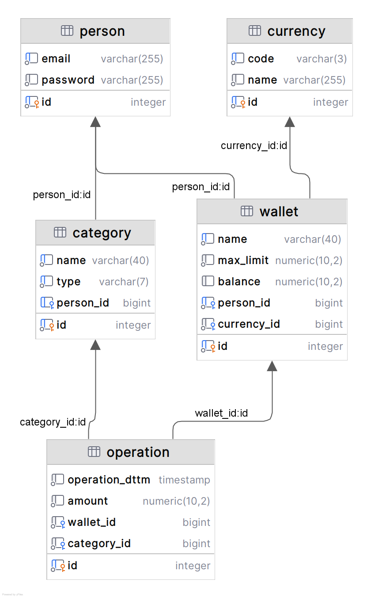

# FinTech Digital Wallet Ledger
Database architecture for multi-currency digital wallet ecosystem

**Author:** Daiana Tei

## Overview
A relational PostgreSQL database architecture for a multi-currency digital wallet.
It enables users to create multi-currency wallets, track income and expenses, and enforce data consistency using ACID-compliant stored procedures.

**Documentation:**
See DesignDocument.pdf.

## Technical Stack
* **Database:** PostgreSQL 15
* **Logic:** PL/pgSQL (Stored Procedures)
* **Infrastructure:** Docker & Docker Compose

## Entity-Relationship Architecture (UML)

*   **Person (User):** Authenticated system users.
*   **Currency:** System-supported currencies (e.g., USD, EUR, RUB, CNY).
*   **Wallet:** Financial containers belonging to a user, strictly bound to a single currency.
Contains maximum limits and current balance.
*   **Category:** Transaction classifications (Income or Expense). Can be global (system defaults) or user-specific.
*   **Operation (Transaction):** The immutable ledger of financial movements.



## Functional Requirements

1. **Financial Data Integrity:**
   
   Monetary values (`balance`, `amount`, `max_limit`) are typed as `decimal(10,2)` to prevent the floating-point rounding errors.
2. **Account Uniqueness:**
   
   A user can only have one wallet with a specific name.
3. **Category Uniqueness:**
   
   A user cannot create duplicate categories of the same type and name.
4. **Global Categories:**
   
   System-default categories are implemented by setting `person_id = NULL`.
5. **Atomic Transactions via PL/pgSQL:**
   
   To prevent Time-Of-Check to Time-Of-Use race conditions from the application layer, state-mutating operations are pushed down to the database.
   The `add_new_operation` procedure atomically validates overdrafts, updates the wallet balance, and inserts the ledger log in a single, isolated transaction.

## Quick Start
1. Start the database container:
   ```bash
   docker-compose up -d
   ```
2. Connect to the database via your preferred SQL client on `localhost:5432` using `postgres` / `password`.
3. Execute `scripts/create_tables.sql` followed by `scripts/dml.sql` to seed the database and compile the procedures.

## Project Structure
* `docker-compose.yml`: Provisions the isolated PostgreSQL environment.
* `scripts/create_tables.sql`: The Data Definition Language defining the normalized 3NF schema.
* `scripts/dml.sql`: Data Manipulation Language containing mock data seeding, analytical time-series queries, and the core Stored Procedures.
* `DesignDocument.pdf`: Documentation

## Stored Procedures

### Safe Transaction Insertion
`add_new_operation` procedure ensures that an expense cannot overdraft a wallet below 0, and an income cannot exceed the wallet's `max_limit`.
If a violation occurs, it rolls back and raises a database-level exception.

### Automated Ledger Adjustments
If a transaction is canceled, `delete_operation` procedure atomically reverts the financial balance before removing the ledger entry.

## Analytical Aggregations
The system supports temporal querying for user dashboards (e.g., retrieving the total income and expense volume over the trailing 30 days).
